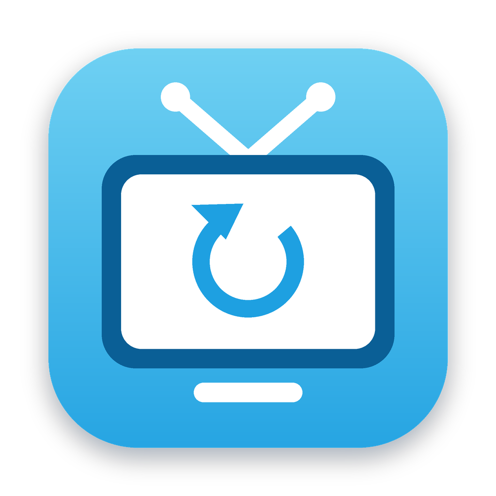

<p align="center"></p>

# torne再起動

Mac で **torne® mobile** が「Dock のアイコンを押しても開かない」ときに、ワンクリックで開き直せるようにする小さなアプリです。
ダウンロードしてアプリケーションフォルダに入れるだけで使えます。

> 本アプリは個人が作成した非公式ツールです。株式会社ソニー・インタラクティブエンタテインメントおよび関連会社とは一切関係ありません。torne は同社の登録商標です。

## こんな症状の人向け

- torne mobile をウィンドウの ×（閉じる）で閉じたあと、Dock のアイコンを押しても**何も起きない**
- Mac を再起動すると、また開けるようになる

Mac 版の torne mobile は iPhone/iPad 版アプリをそのまま動かしているため、× で閉じても**アプリ本体が裏で動き続けます**。その状態だとアイコンを押しても「起動中」と扱われ、ウィンドウが出てきません。

「torne再起動」を開くと、裏に残っている torne を終了してから、あらためて torne mobile を開きます。torne が動いていないときに開いた場合は、普通に torne が起動するだけです。

## インストール

1. [Releases](https://github.com/yoshioka440/torne-relaunch/releases/latest) から `torne-relaunch.zip` をダウンロード
2. zip を開くと「torne再起動」が出てくるので、**アプリケーション** フォルダにドラッグ
3. （おすすめ）アプリケーションフォルダの「torne再起動」を **Dock にドラッグ**して、torne の代わりにこちらから開く

### はじめて開くとき（「開けません」と表示された場合）

このアプリは Apple の公証（有料の開発者登録が必要）を受けていないため、初回は macOS に止められます。次の手順で一度だけ許可してください。

1. 「torne再起動」をダブルクリック →「開けません」等のメッセージが出たら **完了** を押して閉じる
2. **システム設定 → プライバシーとセキュリティ** を開き、下の方にある「“torne再起動”は Mac を保護するためにブロックされました」の横の **このまま開く** を押す
3. 確認が出たら **開く** を押す（パスワードを求められたら入力）

2回目以降は普通にダブルクリックで開けます。

中身が気になる方は、このリポジトリの [`scripts/launch`](scripts/launch) がアプリの中身のすべてです（十数行のシェルスクリプトです）。

## アプリを使わない方法

ターミナルで次を実行しても同じことができます。

```sh
killall torneplus; open -b com.playstation.tornemobile
```

また、torne を終了するときに × ではなく **⌘ + Q**（メニューの「torne mobile」→「終了」）を使えば、この症状は起きにくくなります。

## アンインストール

アプリケーションフォルダの「torne再起動」をゴミ箱に入れるだけです。設定ファイル等は作りません。

## 動作確認環境

- Apple silicon Mac（macOS 26）
- torne® mobile（iPad 版を Mac で利用）

## ソースからビルドする

```sh
git clone https://github.com/yoshioka440/torne-relaunch.git
cd torne-relaunch
./build.sh /Applications     # 引数なしだと ~/Applications に作成
```

### 構成

```
.
├── build.sh          # .app を組み立てる
├── scripts/
│   └── launch        # アプリの中身（torne を終了 → 起動）
└── assets/
    ├── icon.png
    └── AppIcon.icns
```

## ライセンス

[MIT](LICENSE)
